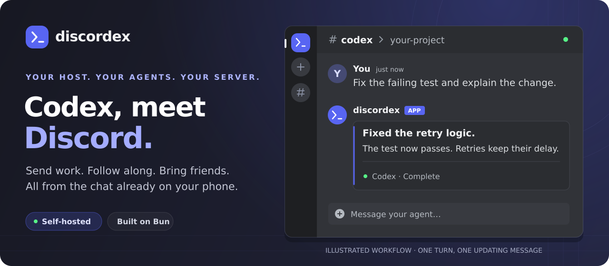

<p align="center">
  
</p>

<h1 align="center">Discordex · OpenAI Codex in Discord</h1>

<p align="center">
  <strong>Your dev box does the work. Your Discord keeps you in the loop.</strong><br />
  A self-hosted Discord bot for managing local Codex agents from your phone, with your friends.
</p>

<p align="center">
  <a href="#quick-start"><strong>Quick start</strong></a> ·
  <a href="https://github.com/hzcafe/discordex/blob/master/docs/architecture.md"><strong>Architecture</strong></a> ·
  <a href="docs/configuration.md"><strong>Configuration</strong></a> ·
  <a href="https://github.com/hzcafe/discordex/issues">Report a bug / request a feature</a>
</p>

<p align="center">
  <a href="https://github.com/hzcafe/discordex/actions/workflows/ci.yml"></a>
  <a href="https://bun.sh"></a>
  <a href="https://www.typescriptlang.org"></a>
  <a href="#quick-start"></a>
</p>

Discordex connects **Discord to the shared local OpenAI Codex daemon**, so you can follow coding sessions, send instructions, and handle tool approvals wherever you use Discord. Keep your local Codex terminal open, pick up a conversation on mobile, or invite friends to work with the same agent.

Built with **Bun, TypeScript, and SQLite**, the bridge consumes structured Codex app-server events and delivers updates automatically. No SSH from your phone, terminal scraping, or model-triggered messaging tools are needed.

> **Early release:** the host service works today. Codex plugin installation and management packaging are still to come. The adapter targets the experimental daemon protocol in **Codex 0.169.0**.

## Why Discordex?

| Feature | What you get |
| --- | --- |
| **Coding agents on your phone** | Send work, steer an active turn, or stop it from Discord while Codex runs on your dev box. |
| **A thread per conversation** | Each eligible top-level session on the shared daemon gets its own Discord thread. Subagents post in their parent's thread with distinct labels. |
| **Live progress without the flood** | One compact message per agent turn, edited as work progresses and finalized with the response. Model and effort appear in the footer when available. |
| **Model and effort controls** | Open a private picker populated from the live daemon catalog. Apply a model and supported reasoning effort to the session's next turns. |
| **Images, videos, and files** | Send a screenshot or clip from Discord for Codex to inspect. Get supported documents and media referenced in final replies back as Discord attachments. |
| **Goals you can manage together** | A shared goal card shows the objective, status, elapsed time, and token budget, with controls to create, pause, resume, change the budget, or clear it. |
| **Approvals where you are** | Buttons for command, file-change, and permission requests; modals for supported input questions. |
| **Work with friends** | Attributed messages let contributors share a conversation. Separate allowlists decide who can send instructions and who can approve actions. |
| **Reconnect and carry on** | SQLite persists thread mappings, message delivery, and approval state so the bridge can recover after a disconnect. |

## How it works

```text
You + friends in Discord
          ↕  messages, progress cards, approvals
Discordex on your dev box  ·  Bun + SQLite
          ↕  structured events over a local Unix WebSocket
Shared Codex daemon  ↔  your local Codex client
```

Discordex connects outbound to Discord's Gateway; it needs **no public HTTP endpoint or inbound port forwarding**. The Codex connection uses a local Unix socket. Exported conversation content goes to Discord, where your channel permissions determine who can read it.

Read the [Discordex architecture guide](https://github.com/hzcafe/discordex/blob/master/docs/architecture.md) for how the daemon discovers sessions, which events become Discord cards, and how SQLite helps the bridge recover after a disconnect.

## Quick start

### 1. Prepare your host and Discord bot

You need **Bun 1.3+** (developed and tested with **1.4.4**), **Codex 0.169.0** with its shared app-server daemon, and a Discord server with a text channel for the bot. Older Codex releases are not assumed compatible. A Linux user-service example is included.

- Create an application and bot in the [Discord Developer Portal](https://discord.com/developers/applications). Enable **Message Content Intent** on the bot settings page.
- Invite it with the `bot` and `applications.commands` scopes and these channel permissions: **View Channel**, **Send Messages**, **Create Public Threads**, **Send Messages in Threads**, **Read Message History**, **Attach Files**, and **Add Reactions**. Administrator is not required.
- Enable Discord's Developer Mode and copy your server, text-channel, and user IDs.

### 2. Install and configure

```sh
git clone https://github.com/hzcafe/discordex.git
cd discordex
bun install --frozen-lockfile
cp .env.example .env
cp discordex.config.example.json discordex.config.json
chmod 600 .env discordex.config.json
```

Set your bot token in `.env`:

```dotenv
DISCORDEX_DISCORD_TOKEN=your-discord-bot-token
```

Edit `discordex.config.json` with your IDs and an **absolute project path**:

```json
{
  "guildId": "YOUR_DISCORD_SERVER_ID",
  "channelId": "YOUR_DISCORD_TEXT_CHANNEL_ID",
  "allowedUserIds": ["YOUR_DISCORD_USER_ID"],
  "approverUserIds": ["YOUR_DISCORD_USER_ID"],
  "autoDiscover": true,
  "projectRoots": ["/absolute/path/to/your/project"]
}
```

Add friends to `allowedUserIds` to let them send instructions. Add people who may authorize actions to `approverUserIds`; every approver must also be a contributor. Keep the token in `.env`, which is gitignored.

### 3. Connect Codex

```sh
codex app-server daemon start
bun run doctor
bun start
```

Open or keep a Codex session running on the shared daemon in a configured project. The bot registers `/codex` in your server and creates a Discord thread for each eligible top-level conversation. **Send a message in that thread to give Codex work.** An inbox reaction confirms the message was recorded.

Initial attachment includes an active turn and future work; it does not copy the entire old conversation. `doctor` checks the local daemon connection without sending prompts or posting to Discord. `start` can launch the default daemon when its socket is missing and leaves it running when Discordex exits.

For an always-on installation, use the [Linux background-service guide](docs/configuration.md#run-as-a-linux-background-service).

## Use Codex from Discord

| Action | Command or interaction |
| --- | --- |
| List eligible loaded sessions | `/codex sessions` |
| Attach a session explicitly | `/codex attach id:<Codex thread ID>` |
| Queue work for the next turn | Send a normal message in a linked thread |
| Share a screenshot, GIF, or video with Codex | Attach it in a linked thread, with or without a caption |
| Add instructions to work in progress | `/codex steer message:<instructions>` |
| Interrupt the current turn | `/codex stop` |
| Inspect connectivity | `/codex status` |
| View remaining allowance and token usage | `/codex usage` |
| Choose the session's model and reasoning effort | `/codex model` in a linked thread |
| View and manage the session's goal | `/codex goal` in a linked thread |
| Answer an approval or question | Use the buttons or modal on its prompt card |

Every allowed user's text in a linked thread reaches Codex, including discussion between friends. Messages in the index channel stay there; bot and webhook messages are ignored.

`/codex usage` replies privately with a compact card: a progress bar and percentage remaining for each reported allowance window, plus its reset time in your Discord locale. These limits belong to the host's Codex account and are shared across sessions. In a linked thread, the card also shows the main agent's last reported session token counts. Run the command again for a fresh account snapshot; missing data is shown as unavailable, never as zero.

`/codex goal` opens one **shared goal card** for the linked conversation. It updates in place when the goal changes in Discord or your local Codex client. Use **Create goal** to enter an objective and optional token budget, **Pause/Resume** to control goal-driven continuation, **Edit budget** to change the total budget, and **Clear** to remove the goal. A completed goal offers **New goal**. Creating or resuming can start work immediately; pausing or clearing does not forcibly interrupt a current turn—use `/codex stop` for that. The goal's emoji budget bar is separate from account allowance.

Each agent turn gets **one message that keeps updating**: working, running a command, editing files, completed commentary, then the final response. Longer final answers include the full text as a file attachment. Approval prompts have separate cards so progress updates never hide a pending decision. Partial token streams and private reasoning text are not exported.

Temporary upload failures recover automatically on the same message, without holding up later messages. A delivery notice explains when files are still arriving or when a size or format limit prevents sharing them in Discord.

## Documentation

| Guide | Covers |
| --- | --- |
| [Configuration and hosting](docs/configuration.md) | Settings, contributor and approver access, Linux service, and troubleshooting |
| [File sharing and media](docs/file-sharing.md) | Incoming media formats and retention, outgoing attachments, sharing roots, and size limits |
| [Architecture](https://github.com/hzcafe/discordex/blob/master/docs/architecture.md) | Bun/TypeScript stack, daemon discovery, editable cards, persistence, and recovery limits |
| [Development](#development) | Local checks, source map, and protocol updates |

## FAQ

### Can I use Codex from my phone without SSH?

Yes. Once Discordex is running on your development machine, use Discord to message your linked Codex sessions, follow progress, and respond to supported approval prompts. Your development machine must remain running and connected.

### Can friends work with the same coding agent?

Yes. Add their Discord user IDs to the contributor allowlist. Messages carry the sender's identity, and multiple people can join the same session thread. Approval access is configured separately.

### Does my local Codex client stay connected?

Yes. Discordex attaches to the shared daemon alongside your local client. It discovers loaded sessions on that daemon within your configured project roots. Sessions using `--no-daemon` or a different daemon are outside its discovery scope.

### What can I send as an attachment?

Send PNG, JPEG, WebP, GIF, AVIF, MP4, MOV, or WebM files in a linked thread. Discordex saves supported originals on the host so Codex can inspect them with tools. Images can also supply a still preview, including the first frame of an animated GIF. For video, the preview uses a thumbnail when the Discord embed supplies one. For voice messages and other unsupported attachments, Codex receives a link and a format notice.

In the other direction, a final reply can share a referenced image or video inline, or attach a document such as a PDF. By default, Discordex looks for those files in the session's working directory. See [sharing roots, supported formats, and limits](docs/file-sharing.md).

### Can I see or change the model in Discord?

Yes. Run `/codex model` in a linked thread to open a private picker. It loads the model names and supported reasoning efforts from the daemon for that session's provider. Choose a model, check the effort, and press **Apply** to use those settings for subsequent turns in the same conversation. **Refresh** reloads the current settings and available models.

Cards display the model and reasoning effort when available. These start from captured session settings; a daemon-reported model reroute updates the turn's label. They are not a per-step execution audit. See [turn cards and model labels](https://github.com/hzcafe/discordex/blob/master/docs/architecture.md#turn-cards-and-model-labels).

### Is self-hosted the same as keeping all data local?

The bridge and Codex daemon run on your host. Exported output, commands, and diffs are sent to Discord and stored locally for delivery. Channel membership controls who can read them; the bot's allowlists control who can submit work or approve actions. See [access and data](docs/configuration.md#access-and-data).

### Is this a Codex plugin I can install today?

Today you run the Bun host service from this repository. Codex plugin installation and management packaging are planned. Some approval types still require the local client; see [approval behavior](docs/configuration.md#approval-behavior).

## Development

```sh
bun install --frozen-lockfile
bun run check
bun test
bun run build
```

Use `bun dev` for watch mode. The build produces a Bun-targeted entry point in `dist/`; production can also run the TypeScript source directly. **Node.js is not a runtime dependency.**

The [architecture guide](https://github.com/hzcafe/discordex/blob/master/docs/architecture.md#source-map) maps the code and explains protocol compatibility. Bug reports and feature requests belong in [GitHub Issues](https://github.com/hzcafe/discordex/issues); include your Bun/Codex versions and reproduction steps, with tokens and private conversation content removed. Pull requests should include the relevant checks above.
